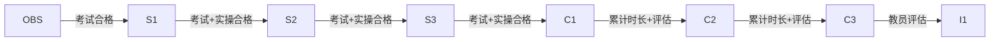

# 考核标准

> 文档编号：OPDOC-CTD-202501-R4-SC
> 版本：R4（修订版 4）
> 生效日期：2026-07-28
> 发布机构：CWFLY 管制员培训中心 CTD
> 参考来源：ICAO Annex 2、Annex 11、Doc 4444；中国民航相关法规
> 许可协议：[CC BY-NC 4.0](https://creativecommons.org/licenses/by-nc/4.0/deed.zh)

---

## 1. 文件修订记录

| 版本 | 修订日期 | 修订内容 | 修订人 |
|------|---------|---------|--------|
| R4 | 2026-07-28 | 初版发布 | Changyang Gui |

---

## 2. 理论考试

### 2.1 考试通用规则

| 项目 | 说明 |
|------|------|
| 考试形式 | 在线考核 |
| 考试时长 | 60 分钟 |
| 合格分数 | 70 分（满分 100 分） |
| 补考规则 | 未通过者可于 7 日后申请补考 |

### 2.2 考试内容与分值分布

| 模块 | 占比 | 覆盖范围 |
|------|------|---------|
| 民航法规 | 20% | ICAO Annex 2、Annex 11、中国民航相关法规 |
| 航空气象 | 20% | METAR/TAF 报文解读、天气现象、气象对飞行的影响 |
| 管制程序 | 30% | 间隔标准、协调移交、进近程序、特情处置 |
| 陆空通话 | 30% | 中英文标准通话用语、数字字母读法、通话示例 |

### 2.3 各等级合格标准

| 等级 | 最低合格分数 | 考试范围 |
|------|------------|---------|
| OBS | 60 分 | 基础理论 |
| S1 | 70 分 | S1 及以下全部内容 |
| S2 | 70 分 | S2 及以下全部内容 |
| S3 | 75 分 | S3 及以下全部内容 |
| C1 | 75 分 | C1 及以下全部内容 |
| I1 | 80 分 | 全部内容 |

---

## 3. 实操考核

### 3.1 考核通用规则

| 项目 | 说明 |
|------|------|
| 考核形式 | 在线模拟管制（使用 EuroScope 等客户端） |
| 考核时长 | 不少于 30 分钟 |
| 合格标准 | 由考官根据综合表现评定 |

### 3.2 考核项目

- 频率管理与通信规范
- 间隔控制与冲突探测
- 协调与移交程序
- 特情应急处理能力

### 3.3 各等级实操要求

| 等级 | 最低管制时长 | 考核场景 |
|------|------------|---------|
| OBS | 5 小时 | 观察学习 |
| S1 | 5 小时 | 地面管制 |
| S2 | 10 小时 | 塔台管制 |
| S3 | 15 小时 | 进近管制 |
| C1 | 20 小时 | 区域管制 |
| I1 | 50 小时 | 教学能力评估 |

---

## 4. 等级晋升条件

### 4.1 晋升流程

### 4.2 晋升附加条件

- 各级晋升需在当前等级任职不少于 30 天
- 晋升申请需由至少一名 I2 及以上教员推荐
- C1 及以上等级晋升需通过面试评估